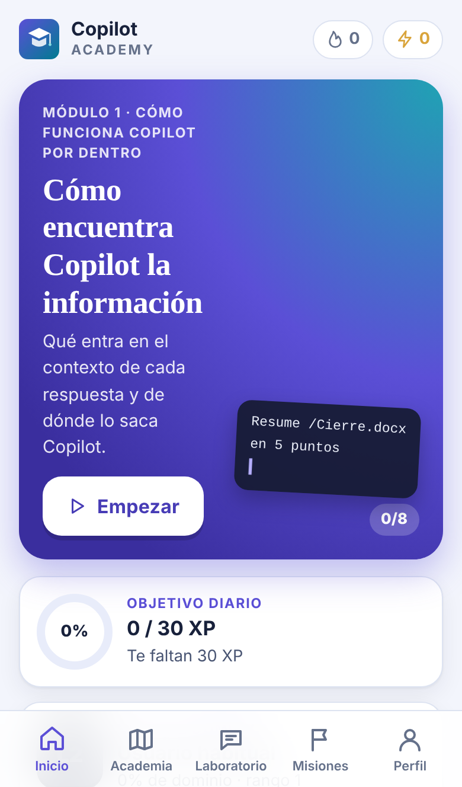
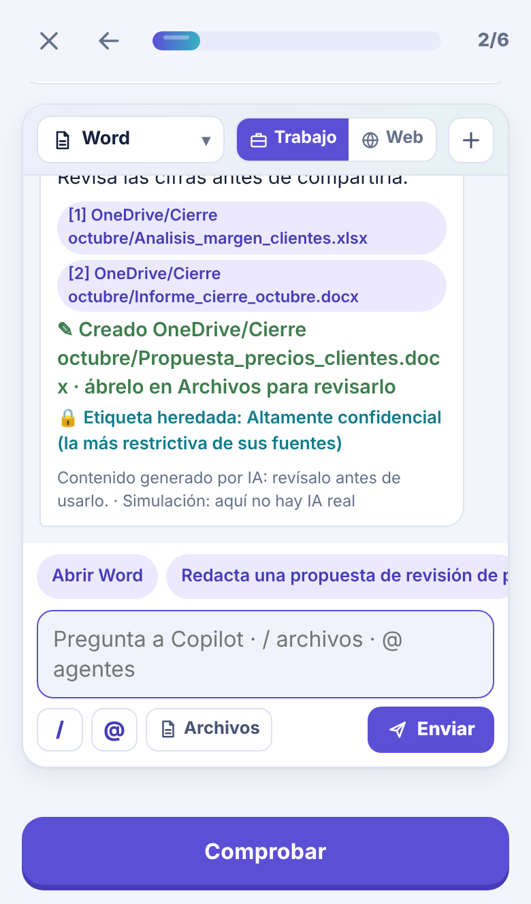
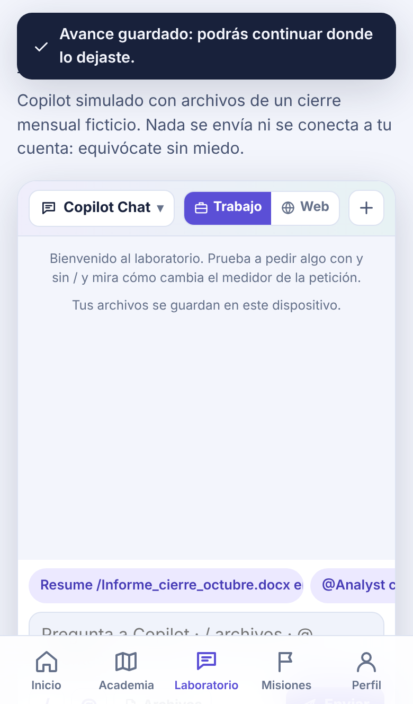
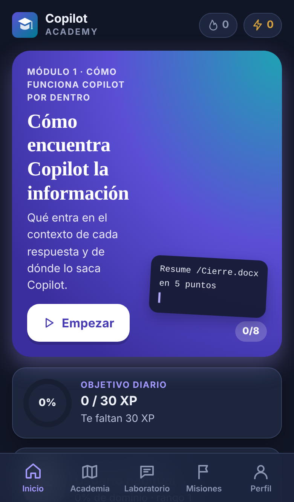

# Copilot Academy

Aplicación web progresiva (PWA) para **dominar Microsoft 365 Copilot y Copilot Studio** partiendo de un nivel L2-L3 (ya usas el chat, resumes y referencias archivos) hasta L5 con sesiones cortas desde el iPhone: microlecciones, un **Copilot simulado** con archivos ficticios, misiones evaluables, evaluaciones por módulo, repaso espaciado y gamificación.

Es la app hermana de [Claude Code Academy](https://github.com/theengineai/Claude-Academy): mismo motor, mismo diseño y misma forma de aprender, con una paleta propia.

- **Sin servidor, sin cuentas, sin APIs de IA, sin claves.** HTML, CSS y JavaScript (módulos ES) servidos como archivos estáticos.
- **Funciona sin conexión** tras la primera carga (Service Worker con precaché de todo).
- **Progreso local** en el dispositivo (`localStorage`), con copia de seguridad exportable.
- **No se conecta a tu cuenta de Microsoft**: el Copilot de la app es una simulación y lo dice en cada respuesta.
- Proyecto educativo independiente, sin relación oficial con Microsoft. Microsoft 365, Copilot y Copilot Studio son marcas de Microsoft.

Guías rápidas:
- [Publicar gratis en GitHub Pages](docs/PUBLICAR.md)
- [Instalar en el iPhone](docs/INSTALAR_IPHONE.md)
- [Fuentes y verificación del contenido](docs/FUENTES.md)
- [Qué se ha verificado y cómo](docs/VERIFICACION.md)

<p>
  
  
  
  
</p>

## Probarla en tu ordenador

```bash
python3 -m http.server 4173
# abre http://localhost:4173
```

No abras `index.html` con doble clic (`file://`): los módulos JavaScript y el Service Worker necesitan HTTP.

## Qué incluye

| | |
|---|---|
| Módulos | 7, con evaluación final cada uno (aprobado: 75 %) |
| Microlecciones | 30, de 6–8 minutos: 1–3 ideas nuevas cada una, ejemplo antes de practicar y resumen final. Nivel profesional: no enseña a usar Excel, Word o PowerPoint ni lo básico de Copilot |
| Formatos de ejercicio | opción única/decisión, selección múltiple, ordenar, emparejar, completar, encontrar el error, redactar una petición con criterios y **Copilot simulado con objetivos** |
| Misiones | 14, incluido el proyecto final integrador (el cierre de noviembre) |
| Laboratorio | Copilot simulado libre y persistente + 8 retos |
| Gamificación | XP por precisión, rangos, nivel de dominio L2→L5, racha diaria, objetivo diario, 18 logros, mapa con desbloqueos |
| Aprendizaje adaptativo | Dominio por competencia (8) basado en aciertos, repaso espaciado (cajas de Leitner) y recomendaciones |

### Programa

1. **Cómo funciona Copilot por dentro** (L2 → L3): qué entra en el contexto y dónde busca, por qué no encuentra algo o se equivoca, verificación profesional (trazabilidad, triangulación), instrucciones personalizadas y memoria, permisos y etiquetas de confidencialidad heredadas.
2. **Prompting avanzado** (L3): especificar el resultado (estructura, criterios, ejemplos, huecos), que pregunte y planifique antes, encadenar tareas y traspasar el estado, contradicciones entre fuentes, autocrítica, biblioteca de prompts y prompts programados.
3. **Modelización con Copilot y Analyst** (L3 → L4): auditar un modelo ajeno sin tocarlo, documentarlo y traspasarlo, Monte Carlo y sensibilidades con Python validadas contra el modelo, y contraste de supuestos con contratos y correos.
4. **Reporting integrado** (L4): cifras trazables a su celda, matriz de coherencia entre modelo, nota y presentación, puente de desviaciones que cuadra al euro y el pack mensual como sistema repetible.
5. **Automatizar el trabajo recurrente** (L4 → L5): qué automatizar y con qué nivel, prompts programados y Notebooks, delegar en Copilot Cowork con puntos de control y medir tiempo, calidad, coste y adopción.
6. **Investigación en profundidad** (L5): encargos a Researcher, Pages y Notebooks como espacio de trabajo y fiabilidad de las fuentes.
7. **Agentes y Copilot Studio a fondo** (L5): diseño, instrucciones, conocimiento y acciones, orquestación, temas, herramientas, agentes autónomos con aprobación humana, pruebas, publicación y gobierno.

Los casos usan una empresa ficticia (Brisa Alimentación) y un departamento financiero: cierre mensual, presupuesto, modelo heredado, pack de comité, proveedores y tesorería. Las cifras son coherentes entre sí (el puente del margen cuadra al euro y la simulación de Monte Carlo se ha ejecutado con los parámetros que muestra).

## El Copilot simulado

En lugar de la terminal de Claude Code Academy, aquí se practica con una **ventana de Copilot** que reproduce la forma de trabajar del producto:

- Elegir **dónde** se usa Copilot: Copilot Chat, Word, Excel, PowerPoint, Outlook o Teams, con un archivo abierto o sin él.
- **Trabajo / Web**: en Web no se usan los archivos de trabajo, y la app lo avisa.
- **`/archivo`** añade un documento, correo o reunión como contexto; **`@agente`** invoca a Researcher, Analyst o un agente propio (que sigue activo en esa conversación).
- **Medidor de la petición**: cada respuesta muestra qué elementos tiene tu petición (objetivo, contexto, expectativas y fuente). Es una heurística didáctica, no una evaluación con IA.
- **Archivos**: ver documentos, abrirlos en su app y crear o editar agentes (`Agentes/*.agent.md`). Hay archivos **restringidos** para practicar los permisos y archivos con **etiquetas de confidencialidad**: lo que Copilot genera a partir de ellos hereda la más restrictiva.
- **Nuevo chat** y **Editar en Pages**.
- Cada respuesta termina con «Contenido generado por IA: revísalo» y «Simulación: aquí no hay IA real».

## Estructura

```text
copilot-academy/
├── index.html               Entrada, metadatos iOS y PWA
├── manifest.webmanifest     Instalación (rutas relativas)
├── sw.js                    Service Worker: precaché y modo offline
├── css/                     tokens (colores), base, componentes y pantallas
├── icons/                   icon.svg + PNG generados (scripts/make-icons.cjs)
├── content/                 TEMARIO EN JSON (lo que más editarás)
│   ├── course.json          niveles, competencias y conceptos
│   ├── modules/m1…m7.json   lecciones y evaluación de cada módulo
│   ├── missions.json        misiones y proyecto final
│   └── lab.json             retos del laboratorio
├── js/
│   ├── app.js               arranque, rutas (#/...) y contexto
│   ├── core/                lógica pura y testeable: estado, progreso, repaso, logros, validación
│   ├── sim/                 Copilot simulado: archivos ficticios, peticiones, agentes y objetivos
│   ├── exercises/render.js  interfaz de los 8 tipos de ejercicio
│   ├── ui/                  DOM, iconos, efectos, bloques y la ventana de Copilot (chat-view.js)
│   └── views/               pantallas: inicio, academia, laboratorio, misiones, perfil y actividades
├── tests/                   tests de Node y recorrido de navegador
└── docs/                    guías, verificación y capturas
```

## Mantenimiento y ampliación

### Añadir o editar una lección
1. Abre `content/modules/mX.json` y añade un objeto en `lessons` con `id` único (p. ej. `l2-5`), `title`, `summary`, `minutes`, `objectives` y `steps`.
2. `steps` mezcla **tarjetas** (`"type": "card"`) y **ejercicios**. Cada ejercicio necesita `id` único, `type`, `concept` (uno de `course.json`), `prompt` y `explain`.
3. Ejecuta `npm test`: comprueba IDs, conceptos, respuestas y que cada solución funciona en el simulador.
4. Añade el archivo nuevo a `sw.js` solo si creas un **archivo** nuevo.

> No cambies el `id` de algo ya publicado: el progreso guardado lo referencia.

### Bloques de las tarjetas
`text` (markdown mínimo: `**negrita**`, `` `código` ``, listas `- `), `code`, `cmds` (peticiones o acciones explicadas, con `where`: «Copilot Chat», «Word», «Excel»…), `flow` (diagrama paso a paso animado), `compare` (dos columnas), `tree`, `callout` (`tip`, `warn`, `finance`, `info`), `reveal` (pregunta y respuesta oculta), `chat` (conversación de ejemplo, roles `user` y `copilot`) y `video` (preparado para vídeos propios, con `fallback`).

### Tipos de ejercicio (campos)
| Tipo | Campos |
|---|---|
| `choice` | `options: [{ text, correct?, feedback? }]` (una correcta), `context?` para decisiones |
| `multi` | `options: [{ text, correct?, feedback? }]` |
| `order` | `items` en el orden correcto (se barajan solos) |
| `match` | `pairs: [[izquierda, derecha], …]` |
| `fill` | `template` con `{{0}}`, `blanks: [{ options, answer }]` o `[{ accept: [...] }]`; `code: false` para texto normal |
| `spot` | `lines`, `faulty` (índices desde 0), `notes { índice: explicación }`, `fixed`, `file`, `context?` |
| `editor` | Redactar una petición o unas instrucciones: `file` «Tu petición a Copilot», «Instrucciones del agente» o «Instrucciones personalizadas», `starter` (versión vaga), `solution` (modelo), `checks: [{ label, pattern, flags?, negate?, hint? }]` |
| `copilot` | `setup { files, app?, open?, scope?, restricted?, labels?, actions? }`, `goals`, `solution`, `solutionFiles?` (solo agentes o páginas), `suggestions`, `intro` |

**Soluciones de `copilot`**: cada entrada es una petición o un control de la interfaz: `::app word [archivo]`, `::modo web|trabajo`, `::nuevo`, `::ver archivo`, `::editar Agentes/X.agent.md`, `::pages Título`, `::programar cada lunes`. En la app el alumno usa botones; en la solución que se muestra aparecen como `[Abrir…]`, `[Modo…]`, etc.

**Objetivos (`goals`)**: `prompt` (una petición que cumpla `pattern`, `app`, `open`, `scope`, `agent`, `refs`, `minRefs`, `gces` —número o lista de elementos— y `turn`), `action` (se completó una acción), `app`, `scope`, `viewed`, `exists`, `absent`, `file` (regex sobre el contenido), `frontmatter` (campos del agente y `body`), `newchat`, `label` (etiqueta de un archivo), `scheduled` (prompt programado) y `ran`. Todos llevan `label` y, opcionalmente, `hint`.

**Respuestas simuladas (`setup.actions`)**: si la petición cumple los grupos de `when` (regex sobre el texto sin tildes ni mayúsculas) y lo que exige `needs` (`app`, `open`, `scope`, `refs`, `agent`, `gces`, `turn`), Copilot responde con `reply`, añade las citas de `cites` y escribe los archivos de `writes`. Si falta algo, explica qué falta (personalizable con `needs.say`). No hay IA: es una respuesta definida en el JSON.

```json
"actions": [{
  "id": "nota",
  "when": [["redacta", "borrador", "nota"]],
  "needs": { "app": "word", "refs": ["Informe_cierre_octubre.docx"], "gces": ["expectations"] },
  "reply": ["He redactado un borrador de nota para dirección…"],
  "cites": ["Informe_cierre_octubre.docx"],
  "writes": [{ "path": "OneDrive/Cierre octubre/Nota_direccion_octubre.docx", "content": "…" }]
}]
```

### Ritmo de las lecciones
Una lección = 1–3 ideas nuevas, 6–10 pasos, ejemplo antes de practicar y tarjeta final «Lo esencial». `npm test` lo comprueba (≤ 4 conceptos y ≤ 12 pasos por lección, ≥ 3 formatos de ejercicio, resumen final).

### Progreso y versiones
- Clave `cpa.state` en `localStorage` (distinta de Claude Code Academy, así conviven en el mismo dominio). Si cambias su forma, sube `STATE_VERSION` y añade una migración en `js/core/state.js`.
- Al importar una copia, la XP se **recalcula** a partir de las actividades registradas.
- En cada despliegue el workflow cambia la versión de caché de `sw.js` (usa el commit), así el iPhone descarga la nueva versión en segundo plano.

### Revisar el contenido
Copilot cambia cada mes y sus funciones dependen de la licencia, la región y la configuración de cada organización. Antes de cada edición importante revisa `docs/FUENTES.md` y actualiza la fecha `docsCheckedAt` de `content/course.json`.

## Tests

```bash
npm test                         # motor, simulador, temario (ejecuta cada solución) y PWA
python3 -m http.server 4173      # en otra terminal, desde esta carpeta
BASE_URL=http://127.0.0.1:4173/ npm run test:e2e         # recorrido en navegador
FULL=1 BASE_URL=http://127.0.0.1:4173/ npm run test:e2e  # recorrido íntegro hasta L5
```

El recorrido de navegador necesita Playwright y Chromium en tu entorno de desarrollo (no en producción). Resultados en [docs/VERIFICACION.md](docs/VERIFICACION.md).

## Privacidad
No hay telemetría, cookies de seguimiento ni llamadas de red salvo la descarga de la propia app. Todo el contenido usa datos ficticios (empresa, personas e importes inventados). No añadas al temario datos reales de clientes, extractos, contratos ni credenciales: el repositorio es público.

## Procedencia
El motor de aprendizaje es el de Claude Code Academy. Una primera versión generada con Codex sirvió de punto de partida; se ha sustituido por esta, que reescribe el temario, cambia la terminal por un Copilot simulado y mantiene el estilo de la app hermana.
